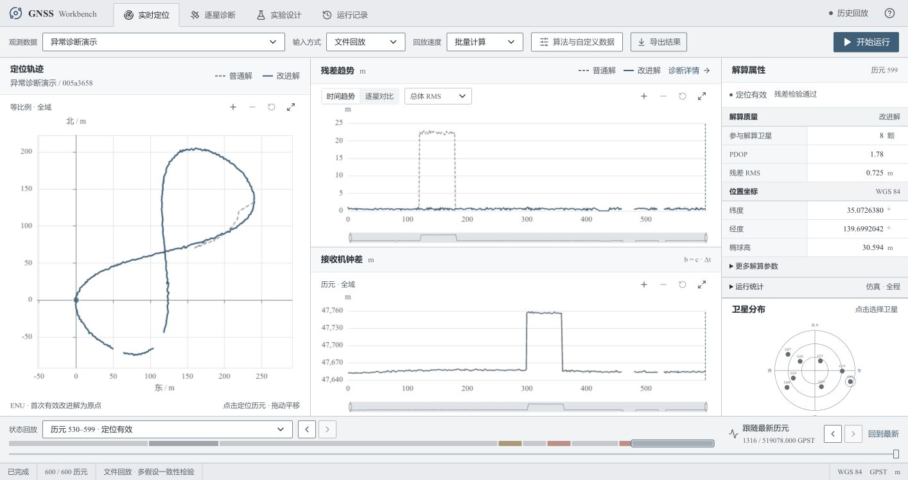
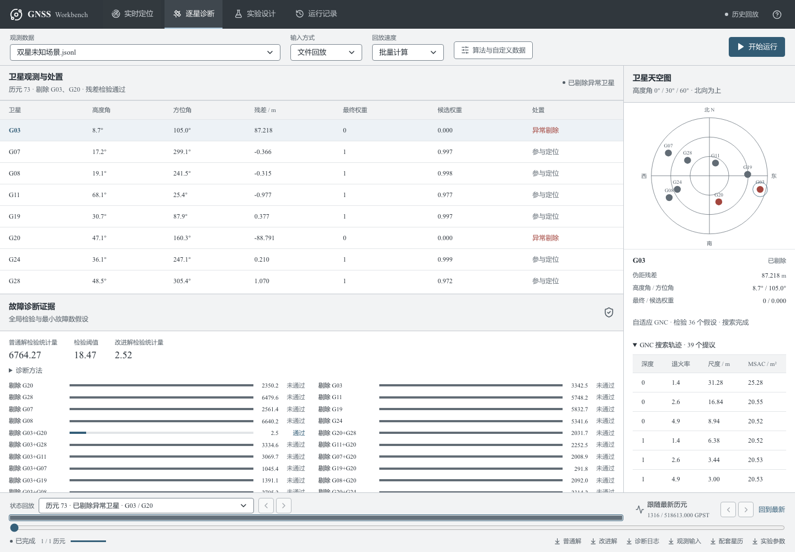

# GNSS Workbench

GPS 单点定位与可解释故障诊断工作台。Mac、Windows 和 Linux 共用 Python 计算核心，通过浏览器运行、诊断和复现实验。

当前版本 **v0.2.0**：真实计算、独立基线、单星/双星诊断、GNC 实验、自定义导入、文件/TCP 输入、运行记录与导出已实现。设计与边界见 [架构](docs/architecture.md)，后续计划见 [路线图](docs/roadmap.md)。

**2026-10-17 提交审查**：[逐项要求、修复与复现记录](docs/submission-review-2026-10-17.md) · [六页课程报告](docs/report.pdf) · [新种子逐例指标](docs/experiments/submission-20261017/summary.json)。公开 D02/D03 通过；新八星 83 例、七星 56 例通过本次所检查的建议线，六星 196 例中仍有 24 例未全部达标。分工按小组要求暂留空，教师隐藏案例与个人答辩尚未验收。



队友加入与提交流程见 [小组协作说明](CONTRIBUTING.md)。受邀成员接受 GitHub 邀请后即可参与开发。

## 已实现

- GPS L1 C1 广播星历解算，卫星钟差、地球自转、电离层和对流层改正；逐历元独立最小二乘。
- 普通解与改进解并行比较；卡方残差检验、最多两星排除候选检验，展示阈值、残差和决策证据。
- 0 星、少于 4 星、恰好 4 星、几何退化等状态明确区分；无效坐标留空，禁止沿用旧定位值。
- TCP 拆包/粘包、暂停与恢复、异常断开、正常结束；浏览器重连和历史快照。
- 可配置单星偏差、渐变偏差、共同偏差、观测缺失；可关闭故障处理做消融实验。
- SQLite 运行索引，原始/变换后输入、参数、版本、哈希、CSV 和逐星诊断持久化。

## 快速运行

安装 Git、[uv](https://docs.astral.sh/uv/getting-started/installation/)、Node.js 24 和 pnpm 11。仓库为私有仓库，需要当前账号或受邀协作者权限。

```bash
git clone https://github.com/sadfaxzda/gnss-workbench.git
cd gnss-workbench
uv sync --locked
pnpm --dir web install --frozen-lockfile
pnpm --dir web build
uv run gnss serve
```

打开 **http://127.0.0.1:8000**，选择数据并开始运行。API 文档：**http://127.0.0.1:8000/api/docs**。

开发时另开终端运行 `pnpm --dir web dev`，访问 **http://127.0.0.1:5173**；Vite 将 API 和 WebSocket 转发给 8000 端口。运行数据保存在 `runtime/`，不提交到 Git。`GNSS_RUNTIME_ROOT` 可指定其他目录。

演示机需安装 **微软雅黑（中文）与 Times New Roman（英文、数字）**。网页与图表使用本机字体；缺少时会回退。字体来源、Mac 粗体兼容处理及配色调研见 [界面调研与字体规则](docs/interface-research.md)。仓库不附带字体二进制。

命令行解算使用同一计算核心：

```bash
uv run gnss solve --input fixtures/course/data/D03_sim_demo.jsonl --out runtime/cli-demo --truth fixtures/course/reference/D03_sim_demo_truth.csv
```

真值仅在计算结束后评估使用。浏览器 ENU 轨迹以本次首个有效改进解为原点，**轨迹偏移和双解差值不代表真实定位误差**；有真值时，评估页另行报告误差。

## TCP 演示

先在终端启动课程提供的服务端，再在网页选择同一数据、`TCP 实时接入`、端口 `8765` 并开始：

```bash
uv run python fixtures/course/tools/replay.py --input fixtures/course/data/D03_sim_demo.jsonl --port 8765 --interval 0.02 --pause-before 200 --pause-seconds 5
```

TCP 参数以流内元数据为准；暂停超过阈值会显示数据过期。不会虚构暂停期间的历元。当前断流会保留证据并终止本次运行，下一次连接建立新运行。

## 验证

```bash
uv run ruff check .
uv run ruff format --check .
uv run pyright
uv run pytest -q
uv run python scripts/verify_fixture.py
uv run python scripts/validate_course.py
pnpm --dir web lint
pnpm --dir web test
pnpm --dir web build
pnpm --dir web exec playwright install chromium webkit
pnpm --dir web test:e2e
```

修改 API 后重新生成类型：

```bash
uv run python scripts/export_schema.py
pnpm --dir web exec openapi-typescript src/generated/openapi.json -o src/generated/api.d.ts
```

GitHub Actions 对 Python 的 macOS/Windows/Linux 运行检查，在 Linux 上执行前端检查与 Chromium/WebKit 浏览器测试。

若本机默认端口被其他项目占用，开发/浏览器测试支持独立端口；已有应用可继续运行：

```bash
uv run gnss serve --port 18000
# 开发前端（另一个终端）
GNSS_API_PORT=18000 GNSS_WEB_PORT=15173 pnpm --dir web dev
# 完整浏览器测试自行管理本项目服务
GNSS_API_PORT=18000 GNSS_WEB_PORT=15173 pnpm --dir web test:e2e
```

构建后的界面可直接在API端口打开，无须另起开发前端。

| 公开数据 | 普通解水平 P95 | 改进解水平 P95 | 说明 |
|---|---:|---:|---|
| D02 无故障模拟 | 1.59 m | 1.59 m | 600 历元，未触发误报 |
| D03 故障演示 | 23.86 m | 1.59 m | 60 个强故障历元全部检出；30 个观测不足历元正确标记 |
| D01 真实片段 | — | — | 20 历元可解算，无独立真值，不宣称真实精度 |

这些是公开开发数据的回归结果，不代表隐藏测试表现或成绩保证。完整边界见 [验证记录](docs/validation.md)。

## 工程与创新方向

React / TypeScript / Vite / Tailwind / Radix primitives / TanStack Query / ECharts；FastAPI / Pydantic / NumPy / SciPy；SQLAlchemy / Alembic / SQLite；uv / pnpm 锁文件；pytest / Vitest / Playwright / GitHub Actions。

当前特色是**诊断证据可追溯、故障实验可配置、双算法对照可复现**。卡方检验和逐星排除是已有方法，项目不将其包装成原创算法。本轮已加入多故障对照、ICCV 2025 SAC-GNC 启发的实验算法及 Stanford 工具校验。方法来源与未复现部分见 [研究说明](docs/research.md)，后续重点见 [路线图](docs/roadmap.md)。

`fixtures/course/` 保留用户提供的课程包，`reference/` 只供测试与事后评估。课程包、真实观测和 RTKLIB 来源/许可见原包 README、provenance.json、LICENSE_RTKLIB.txt。本仓库未为这些第三方材料另行授权；公开仓库前需先明确课程资料的发布范围。原包任务书与原包哈希清单存在一个既有不一致，见验证记录，原文件未被修改。

## v0.2 算法与验收



默认 `consensus`：先检验单星假设，若没有候选通过才检验双星。多个单星候选通过时，比较当前及至多16个已接收历元的残差相对似然；达到20:1且当前残差/几何检验通过才考虑确认身份。历史最优被当前检验否定、出现明确换星证据、时间或观测集合不连续时清空历史。证据不足及双星归因不唯一时保留 SUSPECT。`single_fde` 保留旧版，`adaptive_gnc` 为论文启发的实验路径。关闭 FDE 始终得到独立等权基线。

当前增加带符号故障幅度的变化检验，并区分暂定位置与确认身份。多个单星候选通过、身份仍有歧义时，可暂定剔除相对似然领先的一星并重算当前位置，但状态保持`SUSPECT`、界面标为“待确认”。当前与历史最优一致才允许历史确认；不把全部候选都标记为故障。暂定模式提高定位覆盖，同时可能增加误选，需连同错误确认数和全部误选数报告。

**最新结果见 [第八轮算法取舍与选择证据](docs/diagnosis-iteration8.md)**：新增51,923个输入历元的同输入验证；历史条件提议使高噪声P95从26.366m降至24.504m、错剔1137→1063，但新增一个不规则案例失败，因此默认关闭，仅通过`--enable-coherent-proposals`开启实验。新增选择来源、历元数与证据门槛展示，修复旧单星记录的采用行。160项pytest、16项Vitest、16项双浏览器流程及构建通过；失败完整保留。

[第六轮算法改进与45,283历元验证](docs/diagnosis-iteration6.md)继续有效：已修正历史证据的噪声尺度、增加候选水平解差、覆盖完整换星边界。六星孤立首历元P95仍32.840m，部分冷启动、换星星组、可见集合变化及四/五星故障精度仍失败。八星通过不覆盖这些限制。

历史快照见 [第一轮](docs/low-redundancy-validation.md)、[第二轮](docs/six-satellite-iteration2.md)、[第三轮](docs/diagnosis-iteration3.md)、[第四轮](docs/diagnosis-iteration4.md)、[第五轮](docs/diagnosis-iteration5.md)；当前默认行为及验证以第六轮记录为准。

```bash
uv run python scripts/validate_six_satellite.py --comparison iteration6 --suite continuous --seed 624291 --out runtime/six-validation-v6
uv run python scripts/validate_six_satellite.py --comparison iteration6 --suite stress --seed 624294 --out runtime/six-stress-v6
uv run python scripts/validate_six_satellite.py --comparison ablation --suite eight --seed 625308 --out runtime/eight-validation-v7
# 同输入关闭本轮尺度修正，对照第五轮默认方法：
uv run gnss solve --input YOUR_INPUT.jsonl --out runtime/previous-method --disable-history-rescaling
# 独立等权普通解消融：
uv run gnss solve --input YOUR_INPUT.jsonl --out runtime/no-fde --disable-fde
```

```bash
uv run gnss solve --input fixtures/course/data/D03_sim_demo.jsonl --out runtime/gnc-demo --algorithm adaptive_gnc
uv run gnss benchmark --out runtime/benchmark --seed 20261016 --samples 84
uv sync --group research
uv run --group research gnss cross-check --out runtime/cross-check.json
```

网页“算法与自定义数据”支持导入 JSONL 与可选星历（最多5000历元/16MiB），未给星历则用课程周1316星历；更长输入使用 CLI。参数、输入和逐星决策可完整导出。

[教师要求矩阵](docs/requirements-matrix.md) · [第六轮6页实验报告](docs/report.pdf) · [预设实验设计](docs/algorithm-plan.md) · [保留种子完整结果](docs/experiments/holdout-report.md) · [原始实验归档](docs/experiments/holdout-evidence.zip)

保留种子20261016，每类84历元：双星故障的10m内成功率由旧版单星FDE的1.2%提升到95.2%，水平P95由78.24m降至3.47m；正常/单星/渐变回归保持通过。GNC最终精度相同、耗时更高，保留实验选项。重尾与sigma失配仍出现失败和错剔，不能据此宣称真实环境领先。

## 界面与交付完善

- 按已接收的实际状态生成回放区段，可直接定位故障、四星、少星、无观测与恢复的起点。
- 采用灰白工作区与单一蓝色主要操作，红色/琥珀色仅提示实际异常；普通/改进轨迹同时以线型和颜色区分。标题、正文和字段使用统一内边距，手机保留文字导航。
- 卫星数据网格支持排序、筛选、列宽调整、键盘选择和复制；检验证据以双解对照表呈现。回放控制与应用状态栏分开，结果从工具栏“导出结果”下载。
- 残差支持全程趋势及逐星对比；轨迹、残差与钟差可缩放、平移、复位和展开，残差/钟差共享时间窗。
- CLI 遇到不可恢复的坏帧，保存此前已经完成的两份CSV、诊断日志与失败manifest，并以非零状态退出。`solve --out` 要求空目录，避免覆盖证据或混入旧评价结果。
- [界面规范](DESIGN.md) · [现场演示与答辩准备](docs/demo-guide.md)。

从已提交、工作区干净的Git仓库制作可核验交付包：

```bash
pnpm --dir web build
uv run python scripts/package_submission.py --out ../GNSS_Workbench_submission.zip
```

本目录是下载的源码副本，没有Git元数据。使用显式快照模式（不会虚构提交号）：

```bash
uv run python scripts/package_submission.py --source-snapshot --out ../GNSS_Workbench_iteration8_candidate.zip
# 解压后进入gnss-workbench目录，验证所有交付文件
python scripts/verify_submission.py --root .
```

包内包含源码、锁文件、构建前端、6页报告、D01/D02/D03新运行结果与D03消融，以及逐文件SHA256清单。结果从本次封存的源码运行生成，运行记录保留同一源码身份。解压后无需Node构建即可 `uv sync --locked`、`uv run gnss serve`；首次安装Python依赖仍需网络。打包不包含本机运行历史、Git凭证、虚拟环境或node_modules；校验用于检测改动，不是数字签名。输出ZIP必须不存在。

报告已更新到第八轮，已记录马晨曦、张淳贺、刘芸睿；实际分工与个人核验待确定，见[演示与分工表](docs/demo-guide.md)。重新生成：`uv run --group research python scripts/build_iteration8_report.py`；早期报告脚本保留作为历史记录。

当前报告由 `uv run --group research python scripts/build_submission_report.py` 生成，读取本次封存指标及 `docs/team.json`。本机安装微软雅黑和 Times New Roman；其他系统可通过 `GNSS_REPORT_CHINESE_FONT`、`GNSS_REPORT_ENGLISH_FONT` 指定已安装字体。交付 PDF 已嵌入字形，阅读报告无需安装字体。此前各轮报告脚本仅用于重建历史版本。
