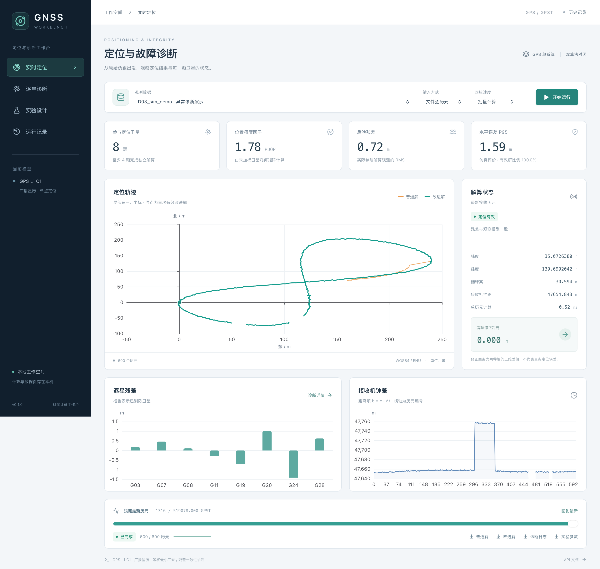

# GNSS Workbench

GPS 单点定位与可解释故障诊断工作台。Mac、Windows 和 Linux 共用 Python 计算核心，通过浏览器运行、诊断和复现实验。

当前版本 **v0.1.0**：真实计算、独立基线、单星故障检测与剔除、文件/TCP 输入、运行记录与导出已实现。设计与边界见 [架构](docs/architecture.md)，后续计划见 [路线图](docs/roadmap.md)。



## 已实现

- GPS L1 C1 广播星历解算，卫星钟差、地球自转、电离层和对流层改正；逐历元独立最小二乘。
- 普通解与改进解并行比较；卡方残差检验、单星排除候选检验，展示阈值、残差和决策证据。
- 0 星、少于 4 星、恰好 4 星、几何退化等状态明确区分；无效坐标留空，禁止沿用旧定位值。
- TCP 拆包/粘包、暂停与恢复、异常断开、正常结束；浏览器重连和历史快照。
- 可配置单星偏差、渐变偏差、共同偏差、观测缺失；可关闭故障处理做消融实验。
- SQLite 运行索引，原始/变换后输入、参数、版本、哈希、CSV 和逐星诊断持久化。

## 快速运行

安装 Git、[uv](https://docs.astral.sh/uv/getting-started/installation/)、Node.js 24 和 pnpm 11。仓库为私有仓库，需要当前账号或受邀协作者权限。

```bash
git clone https://github.com/sadfaxzda/gnss-workbench.git
cd gnss-workbench
uv sync --locked
pnpm --dir web install --frozen-lockfile
pnpm --dir web build
uv run gnss serve
```

打开 **http://127.0.0.1:8000**，选择数据并开始运行。API 文档：**http://127.0.0.1:8000/api/docs**。

开发时另开终端运行 `pnpm --dir web dev`，访问 **http://127.0.0.1:5173**；Vite 将 API 和 WebSocket 转发给 8000 端口。运行数据保存在 `runtime/`，不提交到 Git。`GNSS_RUNTIME_ROOT` 可指定其他目录。

命令行解算使用同一计算核心：

```bash
uv run gnss solve --input fixtures/course/data/D03_sim_demo.jsonl --out runtime/cli-demo --truth fixtures/course/reference/D03_sim_demo_truth.csv
```

真值仅在计算结束后评估使用。浏览器 ENU 轨迹以本次首个有效改进解为原点，**轨迹偏移和双解差值不代表真实定位误差**；有真值时，评估页另行报告误差。

## TCP 演示

先在终端启动课程提供的服务端，再在网页选择同一数据、`TCP 实时接入`、端口 `8765` 并开始：

```bash
uv run python fixtures/course/tools/replay.py --input fixtures/course/data/D03_sim_demo.jsonl --port 8765 --interval 0.02 --pause-before 200 --pause-seconds 5
```

TCP 参数以流内元数据为准；暂停超过阈值会显示数据过期。不会虚构暂停期间的历元。当前断流会保留证据并终止本次运行，下一次连接建立新运行。

## 验证

```bash
uv run ruff check .
uv run ruff format --check .
uv run pyright
uv run pytest -q
uv run python scripts/verify_fixture.py
uv run python scripts/validate_course.py
pnpm --dir web lint
pnpm --dir web test
pnpm --dir web build
pnpm --dir web exec playwright install chromium webkit
pnpm --dir web test:e2e
```

修改 API 后重新生成类型：

```bash
uv run python scripts/export_schema.py
pnpm --dir web exec openapi-typescript src/generated/openapi.json -o src/generated/api.d.ts
```

GitHub Actions 对 Python 的 macOS/Windows/Linux 运行检查，在 Linux 上执行前端检查与 Chromium/WebKit 浏览器测试。

| 公开数据 | 普通解水平 P95 | 改进解水平 P95 | 说明 |
|---|---:|---:|---|
| D02 无故障模拟 | 1.59 m | 1.59 m | 600 历元，未触发误报 |
| D03 故障演示 | 23.86 m | 1.59 m | 60 个强故障历元全部检出；30 个观测不足历元正确标记 |
| D01 真实片段 | — | — | 20 历元可解算，无独立真值，不宣称真实精度 |

这些是公开开发数据的回归结果，不代表隐藏测试表现或成绩保证。完整边界见 [验证记录](docs/validation.md)。

## 工程与创新方向

React / TypeScript / Vite / Tailwind / Radix primitives / TanStack Query / ECharts；FastAPI / Pydantic / NumPy / SciPy；SQLAlchemy / Alembic / SQLite；uv / pnpm 锁文件；pytest / Vitest / Playwright / GitHub Actions。

当前特色是**诊断证据可追溯、故障实验可配置、双算法对照可复现**。卡方检验和逐星排除是已有方法，项目不将其包装成原创算法。后续重点是噪声建模、复杂故障下的适用边界和系统化实验，详见 [路线图](docs/roadmap.md)。

`fixtures/course/` 保留用户提供的课程包，`reference/` 只供测试与事后评估。课程包、真实观测和 RTKLIB 来源/许可见原包 README、provenance.json、LICENSE_RTKLIB.txt。本仓库未为这些第三方材料另行授权；公开仓库前需先明确课程资料的发布范围。原包任务书与原包哈希清单存在一个既有不一致，见验证记录，原文件未被修改。
