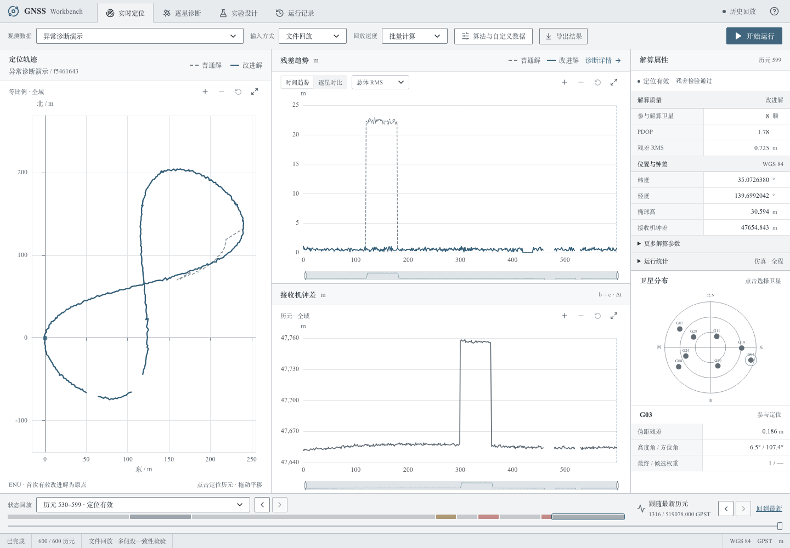

# GNSS Workbench

原始 GPS L1 C1 伪距驱动的单点定位与故障诊断系统，课程提交版整理于 2026-10-28。

仓库地址：<https://github.com/sadfaxzda/gnss-workbench>。仓库目前为私有，需要所有者或受邀协作者权限；邮件提交目录自带完整源码、课程数据、前端构建、结果与日志，运行不依赖 GitHub 访问权限。

默认方法为 `consensus`。普通解始终为独立等权最小二乘；改进解根据残差检验、候选子集和因果历史证据诊断故障。`coherent_proposals` 是默认关闭的实验选项。本项目不声称已通过教师隐藏测试。



## 先看这些文件

| 路径 | 用途 |
|---|---|
| `docs/report.pdf` | 六页实验报告，含 UI 实拍、成功案例、消融、局限和分工 |
| `docs/submission-review-2026-10-28.md` | 本次审查、修复、检查结果与核验方法 |
| `submission-results/` | 邮件包中的普通/改进 CSV、逐星诊断、消融及六星局限案例 |
| `docs/experiments/submission-20261028/` | 本次指标、分段分析与验证记录 |
| `src/gnss_workbench/core/` | 广播星历、改正、四未知数定位和故障诊断 |
| `src/gnss_workbench/` | CLI、API、文件/TCP、评价及持久化 |
| `web/src/`、`web/e2e/` | UI 源码和浏览器测试 |
| `tests/`、`scripts/` | 自动测试、复现、报告与打包脚本 |
| `fixtures/course/` | 原样保留的 26 个教师文件，真值仅供事后评价 |
| `docs/team.json`、`docs/demo-guide.md` | 小组分工与现场核验流程 |

`docs/diagnosis-iteration*.md`、`docs/experiments/` 其他日期目录及早期报告脚本为历史研究证据，结论以所标日期和配置为准。`runtime/` 是运行时生成目录，不作为提交输入。旧版交付 ZIP、虚拟环境、node_modules、Git 元数据与本机运行记录不放入邮件代码文件夹。

## 依赖与安装

- Python 3.12–3.14（项目声明 `>=3.12,<3.15`）；本次实际复核使用 Python 3.14.4。
- Python 依赖由 `pyproject.toml` 声明，`uv.lock` 锁定：NumPy、SciPy、FastAPI、Uvicorn、Pydantic、SQLAlchemy、Alembic、Typer；开发组含 pytest、Ruff、Pyright 和 httpx。
- 重建 UI 需要 Node.js >=22.12、pnpm 11.25.0；`web/pnpm-lock.yaml` 锁定 React、TypeScript、Vite、ECharts 等。**邮件包包含已构建的 `web/dist`，仅运行时无需安装 Node。**
- `uv` 可按 [官方安装说明](https://docs.astral.sh/uv/getting-started/installation/) 安装。首次安装依赖需要网络。报告已嵌入字体，阅读无需额外字体。

在包含本 README 的目录打开终端（邮件包中为“源代码”文件夹）：

```bash
uv sync --locked
uv run gnss serve
```

浏览器打开 <http://127.0.0.1:8000>，选择 D03，选择批量计算后“开始运行”。API 文档为 <http://127.0.0.1:8000/api/docs>。仅在本机回环地址运行。

从仓库首次获取源码时，需先构建前端：

```bash
git clone https://github.com/sadfaxzda/gnss-workbench.git
cd gnss-workbench
uv sync --locked
pnpm --dir web install --frozen-lockfile
pnpm --dir web build
uv run gnss serve
```

提前安装后可用 `uv run --offline gnss serve` 演练离线启动。端口被占用时用 `uv run gnss serve --port 18000`，访问同端口；运行数据可通过 `GNSS_RUNTIME_ROOT` 指定目录。

## 一条命令复现实验

```bash
uv run python scripts/reproduce_submission.py --out runtime/reproduction
```

输出目录必须为空。脚本依次运行 D01、D02、D03、D03 关闭 FDE 的消融，以及公开 D02 派生的六星冷启动局限案例。后者取前 35 历元、每历元前六星，并对 G07 加 -30 m 偏差；生成输入和评价真值一起保留，故障标签不进入定位核心。它是已知失败案例复现，不是新保留测试。

单独复现 D03：

```bash
uv run gnss solve --input fixtures/course/data/D03_sim_demo.jsonl --out runtime/d03 --truth fixtures/course/reference/D03_sim_demo_truth.csv
uv run gnss solve --input fixtures/course/data/D03_sim_demo.jsonl --out runtime/d03-no-fde --truth fixtures/course/reference/D03_sim_demo_truth.csv --disable-fde
uv run python fixtures/course/tools/evaluate.py --input fixtures/course/data/D03_sim_demo.jsonl --truth fixtures/course/reference/D03_sim_demo_truth.csv --solution runtime/d03/improved.csv --out runtime/d03/course-evaluation.json
```

每组含 `baseline.csv`、`improved.csv`、`diagnostics.jsonl`、`manifest.json`；有真值时还有 `metrics.json`。诊断 JSONL 每行包含普通/改进结果，各自的 `diagnostics` 为逐星残差、标准化残差、权重、角度和排除标记；`candidate_scores`、`algorithm_trace` 保存候选、选择依据与历史证据。manifest 保存输入和导航哈希、配置、源码标识。

CSV 严格按作业的 14 列输出；0 星也保留行，无效 XYZ、钟差、PDOP、残差留空。`flagged_sats` 与 `excluded_sats` 区分标记和实际剔除。耗时随机器变化，不能拿来做逐字节复现标准。

## 本次复跑结果与解释

| 数据与配置 | 要求定位历元 | 有效解比例 | 水平 P95 | 10 m 内成功率 |
|---|---:|---:|---:|---:|
| D02 普通 / 改进 | 600 | 100% | 1.590 m / 1.590 m | 100% / 100% |
| D03 普通 | 570 | 100% | 23.859 m | 89.474% |
| D03 改进 | 570 | 100% | 1.594 m | 100% |
| D03 关闭改进 | 570 | 100% | 23.859 m | 89.474% |

D03 共有 600 历元，其中 20 个三星历元和 10 个零星历元不计入要求定位分母；全部行保留。20 个四星历元状态为 `NO_REDUNDANCY`。60 个强故障历元均正确标记/排除 G19，510 个无逐星注入历元误报为 0。D01 的 20 历元可解算但没有独立真值，不报告绝对精度。

成功案例：D03 历元 120–179 的 G19 +80 m 偏差窗口，水平 P95 由 24.450 m 降至 1.738 m。共同 +100 m 的 300–359 窗口，改进解水平 P95 为 1.394 m、米制钟差误差 P95 为 1.388 m，无逐星误报。

局限：六星派生案例首历元真实故障为 G07，却暂定排除 G20，状态保持 `SUSPECT`。此时残差 RMS 仅 0.015 m、PDOP 2.512，水平误差为 33.559 m。低残差和小 PDOP 均不能证明真实精度。六星、冷启动、故障切换、四/五星叠加故障以及高噪声仍有失败，历史扩展记录见 `docs/experiments/submission-20261017/` 与 `docs/diagnosis-iteration8.md`。

上述精度只针对受控仿真。UI 的 ENU 轨迹位移与双解差值不是真值误差。误差分位数必须连同可用率和全体要求定位历元的成功率阅读。

## TCP 实时回放

终端 A：

```bash
uv run python fixtures/course/tools/replay.py --input fixtures/course/data/D03_sim_demo.jsonl --port 8765 --interval 0.02 --pause-before 250 --pause-seconds 5 --event-log runtime/server_events.csv
```

终端 B：`uv run gnss serve`。网页选择 D03 和“TCP 实时接入”，端口 8765，开始运行。超过 `max(3 秒, 3×回放间隔)` 没收到数据时显示过期，恢复后显示恢复事件；不捏造中断期间历元。JSONL 文件模式和 TCP 使用同一核心，算法按输入 GPST 推进，与播放速度无关。

## 自动核验

```bash
uv run ruff check .
uv run ruff format --check .
uv run pyright
uv run pytest -q
uv run python scripts/verify_fixture.py
pnpm --dir web lint
pnpm --dir web test
pnpm --dir web build
pnpm --dir web exec playwright install chromium webkit
pnpm --dir web test:e2e
```

浏览器测试前关闭本项目已运行 API，避免复用旧进程。端口可用 `GNSS_API_PORT`、`GNSS_WEB_PORT` 指定；Windows PowerShell 先设置 `$env:变量名`，macOS/Linux 可在命令前写 `变量名=值`。修改 API 后用 `scripts/export_schema.py` 和 openapi-typescript 重新生成契约。

邮件包完整性核验仅用标准库：

```bash
python scripts/verify_submission.py --root .
```

SHA256 用于检测文件改动，不是数字签名。原教师包任务书与其原始哈希清单存在既有差异；26 个原文件均保持原样，`scripts/verify_fixture.py` 固定核验实际原文件哈希，详见 `docs/validation.md`。

## 小组分工与核验方式

| 成员 | 实际分工 | 建议现场核验 |
|---|---|---|
| 张淳贺 | 完成 UI，先行完成初版编程；共同审查 | 演示双轨迹、逐星信息、状态切换和导出 |
| 马晨曦 | 在张淳贺初版基础上优化；共同审查 | 解释基线、诊断、消融和失败条件 |
| 刘芸睿 | 负责实验报告；共同审查 | 从 CSV 与评价器复核指标，解释案例与局限 |

三人共同审查代码、结果和提交材料。分工依据小组确认；现场核验列为建议流程，不等于个人答辩已完成。AI 辅助用于编码、审查、测试和材料整理，成员需自行解释模型与结果。

## 报告与封装

`docs/report.pdf` 为本次六页报告。可选重建：

```bash
uv run --with reportlab python scripts/build_submission_report.py
```

报告需要已安装的中文及英文字体；可用 `GNSS_REPORT_CHINESE_FONT`、`GNSS_REPORT_ENGLISH_FONT` 指定。源码不分发字体二进制。报告读取本次指标和真实 UI 截图，不调用定位核心制造结果。

从下载源码封装新交付 ZIP（输出路径不得已存在）：

```bash
pnpm --dir web build
uv run python scripts/package_submission.py --source-snapshot --out ../GNSS_Workbench_submission.zip
```

脚本先封存源码和前端，再从封存字节复算所有交付实验，生成源码标识和 SHA256 清单。有 Git 元数据且工作区已提交、干净时可不传 `--source-snapshot`。

数据与第三方来源见 `fixtures/course/README.md`、`data/provenance.json`、`LICENSE_RTKLIB.txt`；方法来源见 `docs/research.md`。保留课程材料的既有许可与发布范围。
