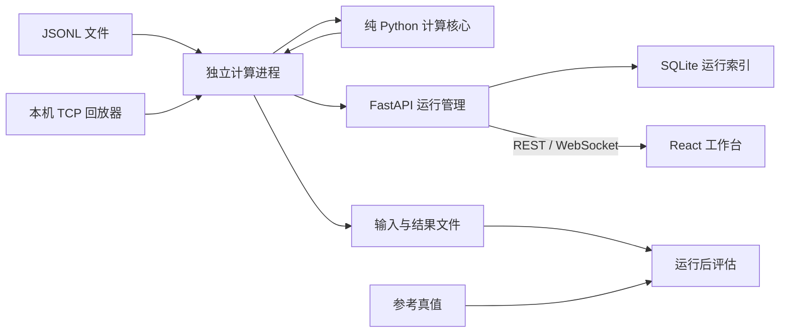

# 架构与扩展约束

## 数据流

## 边界

1. `core/` 只接受观测、广播星历和算法配置。不得读取文件名、数据集 ID、参考真值、固定故障窗口或 Web 状态。前一有效解只用作迭代初值，不进入观测方程或有效性判定。
2. `io.py`、`worker.py` 负责输入、传输、持久化和进程通信。每个真实历元产生一行输出，包括 0 观测历元。计算不会阻塞 API 事件循环。
3. `service.py` 为运行状态的单一拥有者。v0.2 采用单 API 进程、同时一个计算任务；启动多个 Uvicorn worker 会破坏该约束，因此当前不支持多 worker 部署。
4. SQLAlchemy/Alembic 管理 SQLite 元数据与迁移。逐历元大数据写入 JSONL/CSV，浏览器断开不会停止计算；重启时将未完成任务标为 interrupted，不假装恢复已经中断的计算。
5. WebSocket `gnss-stream/1` 发送快照、事件序号、心跳和终态。重连先取持久化快照（每批最多1000历元；后续批次为snapshot_page），前端按epoch_id去重并保留采集顺序；事件缓存溢出要求重新同步。REST 数据结构由 Pydantic 生成 OpenAPI 与 TypeScript 类型。WS 控制事件当前手工对齐，完整代码生成列为后续任务。
6. 输入参数有 Pydantic 校验，TCP 行长度最多 1 MiB，文件下载使用白名单。服务默认仅监听本机；当前没有多用户认证、租户隔离或公网部署配置。

## 算法

- 基线为逐历元等权最小二乘，未知量为 ECEF x/y/z 与以米表示的接收机钟差 b；与课程模型保持一致。
- 改进解先做同一组观测的普通解，再按配置噪声标准差计算残差卡方统计量，自由度 n−4。
- 默认 consensus 检验单星和至多双星假设，选择第一个有候选的最小剔星数。唯一候选满足残差检验、至少5星与几何约束才剔除。多个单星候选通过时，比较全部同维度假设的剖面相对似然；当前或最多16个已接收历元证据达到20:1，且所选候选仍通过当前检验、无强反证，才确认剔除。只缓存残差证据，XYZ和钟差始终用当前保留观测独立解算。无法区分的候选、双星归因不唯一或搜索不完整保留SUSPECT。GNC只排序提议，最终仍用相同的完整无权子集验证。
- `AmbiguityResolver` 属于单次解算引擎：正常恢复、观测集变化、非递增GPST、超过5秒间隔、无效历元、历史最优被当前检验否定或当前数据明确支持不同身份时清空历史。依据GPST而非网络到达时间，文件/TCP相同输入给出相同诊断。20:1不是校准后的正确概率；短窗口假设故障身份短时持续，不能保证任意少星几何或冷启动故障可辨识。参数和逐候选证据写入已有manifest与candidate_scores。
- 六星第二轮扩展：残差投影导出的带符号故障幅度及几何方差提供变化检验，超限清空历史。历史确认要求当前与累计最优一致；当前分歧可降低为SUSPECT而不必抛弃已有位置证据。`provisional_fde`允许使用通过当前检验的领先单星子集给暂定位置，但不会确认身份；`fde_change_detection`控制幅度变化检验和严格确认。暂定结果仅标记/剔除一星，日志明确来源是当前还是历史，所有界面均显示待确认。暂定误选与已确认误判分开评价，见[第二轮验证](six-satellite-iteration2.md)。
- 恰好 4 星可定位但不能基于残差提供冗余检验；少于 4 星不解算。共同伪距偏差可被钟差吸收，不能宣称已检测为单星故障。
- 目前不提供经认证的保护级或完好性风险保证。噪声 sigma 与检验 alpha 会改变误报/检出权衡，必须以实验支持阈值选择。

## 复现与未来优化

每个网页运行保存输入、两套解、诊断、事件和 manifest。manifest 记录输入/星历 SHA-256、软件版本、Git revision 与配置；运行后的独立评价读取参考真值。精确复现应使用已提交且无修改的代码版本以及两个锁文件。

SolverConfig.algorithm 提供 single_fde、consensus、adaptive_gnc 三种策略。任何后续滤波器须继续保留基线与同输入消融。当前 API 导入采用服务器生成的数据集ID，不接受任意文件路径；原始数据与导航保存在 runtime/datasets 下。

长期服务器化再引入认证、PostgreSQL、外部任务队列和对象存储。大批数据应改为分页/分块或降采样显示；当前WS按1000历元分批恢复完整快照，已通过6001历元TCP重载与CSV一致性验证；浏览器仍保存本次全部历元，因此更大规模持续采集需要分层索引和降采样。网页文件导入保持5000历元限制，完整导出不截断。

桌面封装可复用现有前端和本机 API；当前无需为跨平台维护第二套解算器。安装型 wheel/独立可执行分发尚未完成，当前支持从完整仓库运行。
