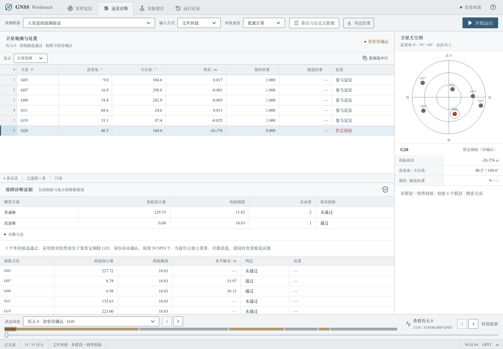

# 第六轮：历史证据尺度修正、候选解差与完整验证

依据2026-10-16提供的原始任务书、MODEL_SPEC、INTERFACE及《GNSS项目算法进度与验证总结》，本轮修正了噪声变化时历史证据过强的问题，补充候选位置差的展示，并修复换星统计遗漏。**公开数据保持通过，新独立高噪声输入有有限改善；六星冷启动、部分星组换星和四/五星故障定位仍不能宣称全面达标。**

## 教师要求复核

| 要求与条件 | 本轮核验与结论 |
|---|---|
| 广播星历、发射时刻、相对论、一次TGD、地球自转、大气改正 | 物理模型未改；普通解准备、线性化、迭代和结果生成四个方法AST一致；公开数据回归通过 |
| GPS L1 C1、独立四未知数、等权普通解、3°截止角 | 保持；公开1220历元普通解逐字段一致，排除耗时；没有固定高度或历史坐标约束 |
| 当前/过去观测，无真值或未来数据参与定位 | 新逻辑只使用已接收候选残差与因果噪声估计；真值只进入生成与事后评分 |
| 普通与改进解并存，至少一次消融 | 增加历史尺度消融；D01/D02/D03关闭FDE后两解逐字段相同，排除耗时 |
| CSV精确14列，一历元一行，无效值为空 | 新旧方法45,283个输入的课程评价契约违规0；公开数据违规0 |
| 0/3/4星、几何失败与缺测 | 全套机制测试通过；新数量变化组140个特定状态判断100%；不将状态通过当作故障精度通过 |
| 文件/TCP同核心，拆包粘包、暂停恢复、有序结束 | 148项Python测试与16项双浏览器完整流程通过；含GPST与发送节奏分离、6001历元及断流测试 |
| 逐星故障依据、误选与限制可见 | 新增当前候选之间的水平解差；暂定剔星继续保持SUSPECT |
| 资料完整与复现 | 原始26个教师文件逐字节一致；保留源码快照、冻结哈希、配置、输入、双解、诊断及全部失败 |
| 4—6页报告、个人贡献、现场答辩 | report.pdf已更新为本轮6页实验报告，逐页渲染核验通过；旧报告另存。真实分工与现场答辩仍需成员完成，未作虚构认定 |

## 实际修改

### 1. 历史相对似然与噪声单位保持一致

第五轮的当前候选残差会除以当前噪声方差，但历史累计值仍按当时的噪声方差保留。如果初始假定1m，后来过去观测支持更大的噪声尺度，早期证据会相对过强，可能继续支配暂定选择或确认身份。

现在为每帧记录统计量及其尺度。当前因果尺度增大时，旧统计量乘以 `(旧尺度/新尺度)²`，带符号偏差的方差同步扩大。尺度降低时不重新放大已折减的旧证据。每帧的保留尺度是该帧进入窗口后经历的最大因果尺度；这是一项保守的工程处理，不是经过校准的后验概率。

例如，8帧各提供1单位候选代价差，旧累计对数证据比为4；尺度从1m升至3m后，新值为4/9，不再达到ln(20)的确认门槛。新增机制测试同时检查尺度回落、变化过程等价性、幅度方差同步及非有限尺度拒绝。

`SolverConfig.rescale_history`默认启用，CLI用`--disable-history-rescaling`对照第五轮行为。逐候选日志新增`history_sigma_m`，表示当前保留历史使用的最大尺度。窗口仍为16历元、名义噪声仍为1m、假警参数仍为0.001、确认比仍为20:1。

### 2. 候选水平解差

多个通过检验的候选可以产生相距很远的位置。现对实际通过的当前历元子集解，计算其相对于本历元采用解的ENU水平距离，保存为`candidate_horizontal_separation_m`，界面增加“水平解差 / m”。采用解为0，未通过候选留空。无选定候选时不编造参照。

这是两个计算结果之间的差异，**不是真值误差、置信区间或保护水平**，不用于修改PDOP、偷偷选择更接近真值的解或改变状态。在既有六星首历元反例中，G20被暂定剔除，而G07候选与采用解相差约33.97m，界面继续显示身份待确认。该反例仍然是误选，不作为精度改善来统计。



观测冗余与四/五星限制可参见[ESA RAIM说明](https://gssc.esa.int/navipedia/index.php/RAIM)；形式精度、DOP与实测误差的区别见[ESA Positioning Error](https://gssc.esa.int/navipedia/index.php/Positioning_Error)。本轮尺度折减与候选解差是本项目工程实现，不声称复现航空认证算法。

### 3. 验证与运行修正

旧验证脚本把快速换星的“前10历元”固定写成15—24，遗漏30和45处的边界；第五轮文档另行重算过完整窗口，但通用脚本不完整。现按事后真实注入标签逐次识别故障出现、身份/符号改变、故障消失，并分别汇总前10个已接收历元。窗口遇到下一变化就截止，避免短故障重复计数；不假设连续epoch_id或1Hz采样，标签不传入求解器。

连续六星现在统计所有1120个换星边界历元和1400个恢复历元。新增每个星组的`case_metrics.json`。目标判定采用预定义“要求输出位置”的分母，并单独检查特殊状态；原始全历元统计仍保留，未删除失败。

本机8000/5173端口已有其他项目使用，因此新增可配置的`GNSS_API_PORT`与`GNSS_WEB_PORT`，默认值不变。此次双浏览器使用18000/15173；未停止其他应用。测试只启动一个本项目API，服务仍绑定127.0.0.1。

## 开发试验与取舍

第五轮输入623281、623283、623288用于开发回归，不能称为新独立验证。

| 同输入对照 | 第五轮 | 尺度修正 |
|---|---:|---:|
| 连续六星渐变强故障P95 | 4.488m | 4.239m |
| 连续六星渐变错剔 | 75 | 70 |
| 高噪声整体P95 | 27.517m | 25.197m |
| 高噪声错剔 / 错误确认 | 1175 / 169 | 1112 / 156 |

试验过用过去带符号偏差的加权直线预测当前偏差，仅用于清除失效历史。它在高噪声开发回放中进一步减小部分误选，但在不规则输入中错剔由67增至69，P95从3.426m增至3.433m，且连续名义噪声没有额外收益。因此没有保留在生产默认或新增可选算法中；实验源码与全部结果保存在`runtime/diagnosis-iteration6/predictive-experiment-source/`和`dev-*`。未根据新冻结测试继续调参数。

## 冻结后的独立输入：45,283历元

按[计划](diagnosis-iteration6-plan.md)冻结数值源码、配置和测试后运行624291—624296。新生成轨迹、钟差、噪声和故障；共享课程星历和物理函数，属于受控仿真，不是教师隐藏案例或外场实测。对每个输入运行第五轮行为与本轮行为，保存全部输入、真值、两份CSV、诊断及失败。

下表P95为整组有效位置的水平误差；10m成功率的分母为要求定位的历元。全部组的要求定位可用率均为100%。标星包含暂定身份；错误确认单独列出。

| 条件 | 历元 | 水平P95 | 10m成功率 | 错剔 / 错误确认 |
|---|---:|---:|---:|---:|
| 连续六星 | 15,680 | 3.283m | 98.32% | 220 / 1 |
| 不规则六星 | 8,064 | 3.207m | 98.35% | 114 / 3 |
| 孤立六星首历元 | 336 | 32.840m | 91.37% | 27 / 0 |
| 2.4m高噪声 | 15,680 | 26.586m | 90.11% | 1156 / 140 |
| 七星 | 4,480 | 2.050m | 100% | 3 / 0 |
| 可见集合变化 | 560 | 5.557m | 95.54% | 14 / 0 |
| 星数变化与中断 | 483 | 37.374m | 84.02% | 2 / 0 |

新高噪声组同输入第五轮→本轮：P95 **27.631→26.586m**，10m成功率 **89.95%→90.11%**，错剔 **1185→1156**，错误确认 **146→140**。整体正常标记/状态误报率均为4.84%；阶跃和渐变组的短正常段分别为12.32%和12.86%，仍有明显失败。改善不等于达标。

其他新组主要数值指标基本相同。本轮没有改善孤立首历元或名义噪声换星难例，不能把跨种子差异当成本轮收益。

### 必须同时阅读的细分失败

- 连续六星冷启动的强故障P95为**27.329m**，10m成功率**93.10%**；虽然整组连续数据P95通过，这一条件失败。
- 连续六星每28个星组中，冷启动/阶跃/渐变/一次换星/快速换星分别有**5/2/2/3/3组**未同时达到强故障P95、成功率和正确标星门槛。
- 不规则六星随机换星/非线性偏差/间歇故障分别有**1/1/4组**失败；仍有3次错误确认。
- 可见集合变化强故障P95 **35.984m**、10m成功率**91.67%**；该组连续冷启动强故障P95 **36.933m**、成功率**75%**。
- 星数变化组140个0/3/4星状态判断正确率100%，但包含四/五星故障的精度仍失败。此轮未重复全部70个四星和56个五星子集的新种子扫描；第五轮对应限制保持有效。
- 连续六星全部换星后前10历元P95 **4.880m**、10m成功率**97.23%**，新旧方法相同；恢复前10历元P95 **2.223m**，出现1次暂定误报。没有隐藏恢复阶段。

[全部汇总](experiments/diagnosis-iteration6/summary.json)、[逐星组指标](experiments/diagnosis-iteration6/continuous-case_metrics.json)、[代表性误选及完整候选证据](experiments/diagnosis-iteration6/failure-examples.json)。每个原始失败保留在对应`runtime/diagnosis-iteration6/final-*/failures.json`，未按结果删减。

## 公开回归与工程证据

- D02：P95 **1.590m**、可用率100%、10m成功率100%、误报0。
- D03：P95 **1.594m**、要求定位570/570有效、10m成功率100%、60/60强故障正确标记、规定0/3/4星状态100%、误报0。
- D01：20历元兼容性通过，不以近似坐标宣称实测绝对精度。
- 公开1220历元普通解逐字段相同，排除耗时；新独立输入普通解最大数值差2.03×10⁻⁷m以内，状态和参与星数相同。差别来自数值初值路径，不是更改普通解模型。
- 教师26个原文件与外层原包逐字节一致；原包既有任务书哈希清单差异继续保留。OpenAPI与生成TypeScript合同不变，冻结后46个Python源码/测试文件哈希不变。
- **148项pytest、13项Vitest、Chromium/WebKit共16项流程测试通过**；Ruff检查及格式、Pyright、ESLint、TypeScript/Vite构建通过；新增列已在实际截图中核对。
- 报告使用scripts/build_iteration6_report.py从冻结指标生成；该报告脚本在数值验证后新增，未改变已冻结的46个Python文件。新报告共6页，已逐页渲染检查；旧报告保存在report-pre-iteration6.pdf。
- 保留告警：依赖的Starlette/httpx弃用提示、Vite既有大包提示，以及测试客户端关闭时的代理EPIPE/ECONNRESET日志。首次沙箱测试不能绑定本机端口、首次浏览器启动端口冲突的失败日志也保留；解决运行条件后完整重跑通过。

## 复现和资料位置

在项目目录运行，输出目录必须为空：

```sh
uv sync --locked
uv run pytest -q
# 重新生成6页报告（需要research依赖组及中文字体）
uv run --group research python scripts/build_iteration6_report.py
uv run python scripts/validate_six_satellite.py --comparison iteration6 --suite continuous --seed 624291 --out runtime/recheck-v6-six
uv run python scripts/validate_six_satellite.py --comparison iteration6 --suite irregular --seed 624292 --out runtime/recheck-v6-irregular
uv run python scripts/validate_six_satellite.py --comparison iteration6 --suite stress --seed 624294 --out runtime/recheck-v6-stress
uv run gnss solve --input YOUR_INPUT.jsonl --out runtime/v5-comparison --disable-history-rescaling
uv run gnss solve --input YOUR_INPUT.jsonl --out runtime/ols-ablation --disable-fde
GNSS_API_PORT=18000 GNSS_WEB_PORT=15173 pnpm --dir web test:e2e
```

本机已按原`uv.lock`安装独立`.venv`，Python 3.14.4；可直接用`.venv/bin/gnss serve --port 18000`打开构建后的工作台。跨电脑继续按README安装依赖。本目录没有Git元数据，未虚构提交编号或推送。

- [冻结源码、配置与预留种子](experiments/diagnosis-iteration6/frozen-final.json)
- [普通解、资料与合同兼容性](experiments/diagnosis-iteration6/compatibility.json)
- [公开D02](experiments/diagnosis-iteration6/D02_sim_clean-metrics.json) / [公开D03](experiments/diagnosis-iteration6/D03_sim_demo-metrics.json)
- [紧凑证据SHA256](experiments/diagnosis-iteration6/SHA256.json)
- 原始输入、真值、双解CSV和逐星诊断：`runtime/diagnosis-iteration6/final-*`。
- 修改前源码：`runtime/diagnosis-iteration6/original`；开发与未采纳试验：同级`dev-*`与`predictive-experiment-source`。

后续应优先补充能区分近共线故障方向的独立证据与更广的几何验证；在课程限定输入下，仍应如实保留SUSPECT和失败解释，不用真值、未来位置或固定高度换取表面精度。

改动前端文件的Prettier检查通过。全目录检查发现原有generated/api.d.ts及generated/openapi.json不符合当前Prettier格式；为保留合同文件字节未重写这两个既有生成文件，此项格式提示不是类型或运行测试失败。
