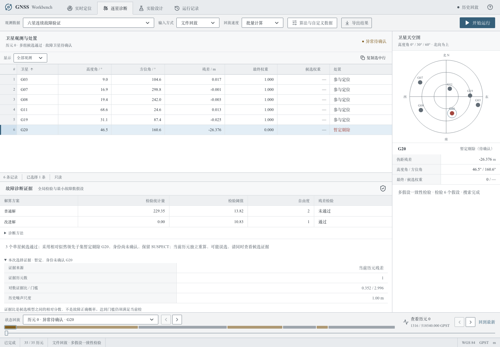

# 第八轮：条件故障提议、独立验证与选择证据展示

2026-10-17。先与第七轮封存交付的404个源文件逐字节核对，随后开展算法试验和界面改进。新增**51,923个输入历元**的同输入对照。实验在高噪声有收益，但引入一个新的名义场景失败，所以**默认保持原行为，实验必须显式开启**。目标仍为教师完整要求，不能以整体收益代替逐场景通过。

## 1. 三项开发试验及取舍

原程序已拟合因果的单星线性偏差，但主要在单历元全局检验未超限时用于身份选择。本轮在强故障歧义时尝试使用该证据。位置始终用当前观测独立拟合，历史不存坐标/钟差先验；不读取真值或未来观测。

| 第六轮输入上的开发回归 | 默认 | 直接线性证据 | 常偏/线性阶数选择 | 仅未确认提议 |
|---|---:|---:|---:|---:|
| 连续六星错剔 | 220 | 228 | 230 | 219 |
| 不规则六星错剔 | 114 | 114 | 112 | 115 |
| 高噪声错剔 | 1156 | 1102 | 1105 | 1117 |
| 高噪声错误确认 | 140 | 148 | 148 | 140 |

前两项使名义六星退化或错误确认增加，未合入。阶数选择参考[Schwarz (1978) BIC原文](https://www.andrew.cmu.edu/user/kk3n/simplicity/schwarzbic.pdf)，不是校准的故障概率；[实验源码和开发指标](experiments/diagnosis-iteration8/)均保留。

第三项保留为显式实验：只有原决策未确认、历史相对分数达到既有20:1、当前子集残差/几何与一步预测均通过、当前没有强反证时，才调整暂定选择。它永远不升级FAULT_EXCLUDED，不替换已确认身份，也不反馈到后续位置初值或诊断证据。`coherent_proposals`默认False；CLI通过`--enable-coherent-proposals`开启。manifest记录实际开关。

开发连续集仅一个历元42.698→3.410m；不规则集另一个历元7.065→45.809m，不能隐去。开发数据属于旧集回归，只有冻结后的下一组算新验证。

## 2. 51,923历元的新独立对照

[计划](diagnosis-iteration8-plan.md)预先固定626311—626318及覆盖范围。冻结候选源码与配置后，同时运行previous（默认关闭）和new（实验开启）；没有根据结果调参。之后仅将部署默认改回关闭、CLI改为显式开启，并令复验命令明确选择两种配置；候选求解函数与冻结哈希一致，变更范围记录在[部署决定](experiments/diagnosis-iteration8/release-decision.json)。

| 场景 | 历元 | 默认P95 / 实验P95 | 默认 / 实验10m成功率 | 默认 / 实验错剔 |
|---|---:|---:|---:|---:|
| 连续六星 | 15,680 | 3.330 / 3.320m | 98.20% / 98.23% | 254 / 250 |
| 不规则六星 | 8,064 | 6.302 / 6.302m | 96.27% / 96.27% | 204 / 204 |
| 孤立六星首历元 | 336 | 30.831 / 30.831m | 91.37% / 91.37% | 29 / 29 |
| 2.4m噪声压力 | 15,680 | 26.366 / 24.504m | 90.12% / 90.52% | 1137 / 1063 |
| 七星 | 4,480 | 2.157 / 2.157m | 100% / 100% | 0 / 0 |
| 可见集合变化 | 560 | 2.317 / 2.317m | 98.93% / 98.93% | 6 / 6 |
| 数量变化与中断 | 483 | 79.780 / 79.780m | 72.88% / 72.88% | 8 / 8 |
| 八星完整覆盖 | 6,640 | 1.769 / 1.768m | 100% / 100% | 1 / 0 |

所有要求定位历元可用率100%；两种配置普通解数值字段完全一致（排除耗时），课程CSV契约违规0；140个特设0/3/4星状态判断100%。高噪声错误确认均184次，正常误报率均4.27%；没有通过新增确认获得表面收益。八星83例逐例通过，默认出现的1次错剔属于弱故障；强故障正确标记率100%。七星本轮全部通过。

P95基于有效位置，10m成功率分母为全部要求定位历元。基础噪声为0.8m白噪声加0.25m平滑扰动；2.4m是额外压力。共享课程星历和物理函数，有共同模型局限，不是教师隐藏或外场测试。

### 新增失败决定默认不开启

不规则`set23-random_switch`第31历元，实际G19注入−35.721m：默认暂定剔G19，误差0.431m；实验暂定剔G11，误差22.051m。整例96历元10m成功率从95.83%降至94.79%，由通过变为失败；整例P95从4.273m增至6.296m。两者均保持SUSPECT，错误确认0。**这项失败不能被总体平均不变掩盖。**

相反，高噪声`set20-03-step`第13历元实际G28+85.801m，默认暂定剔G20导致198.324m误差，实验改为暂定剔G28后3.240m。高噪声整体改善仍没有达到教师10m建议线。

默认和实验在连续六星分别有18/17例未同时达到全部门槛，不规则15/16例，高噪声146/145例；新解决连续快速换星和高噪声阶跃各1例，却新增上述不规则失败。逐例统计包括可用率、正常误报与全部要求定位历元的成功率，不只检查强故障片段。

[全部汇总](experiments/diagnosis-iteration8/summary.json)、[全部改变的决策](experiments/diagnosis-iteration8/changed-decisions.json)、[代表性成功与失败](experiments/diagnosis-iteration8/representative-decisions.json)、逐类/逐例指标、输入哈希与冻结配置均在`docs/experiments/diagnosis-iteration8/`。完整输入、真值、双解与逐星日志保留在`runtime/diagnosis-iteration8/final-*`。

## 3. 界面与旧记录修复

“逐星诊断”新增可展开的“本次选择证据”，显示实际排除星、当前/历史来源、使用历元数、对数证据比与门槛及历史噪声尺度，明确分数不是故障正确概率。当前暂定选择使用其当前相对份额计算比分，不误显示另一历史领先候选的比分；缺失字段为空，不补0。高历史分数不会将SUSPECT显示为确认。

旧单星FDE日志没有`selected`字段，原候选表会漏标已采用的排除行。现在以实际`excluded_sats`为依据，兼容旧日志；即使可选selected字段冲突，也以实际处置为准。



## 4. 机制、工程和兼容检查

- 160项pytest、16项Vitest、Chromium/WebKit共16项流程通过；Ruff与格式、Pyright、ESLint、TypeScript/Vite构建通过。
- 6项新Python机制/CLI测试：提议保持SUSPECT，不改变普通解、初值和后续残差历史；当前检验、预测、相对证据缺失不能绕过；默认关闭、显式开启及manifest对应。测试输入来自已知开发集，不计入新验证。
- 3项前端测试覆盖旧日志采用行、当前/历史比分分离、高分不升级确认；浏览器流程检查新证据文字、旧有TCP/恢复/导出和窄屏，已查看实际截图。
- 原始26个教师文件、物理改正、14列CSV和API模型保持不变。最终公开回归与交付校验附在交付核验记录中。
- 保留Starlette/httpx弃用、Vite大包和浏览器关闭代理连接提示。新测试扩展到完整80历元时，曾把门限测试错指向最后的正常历元；已改回指定第44历元，完整重跑通过，初次失败日志保留。
- 六页报告更新至本轮，前版另存`report-pre-iteration8.pdf`。马晨曦、张淳贺、刘芸睿姓名已确认；真实分工和个人核验仍待确定。

## 5. 复现

```bash
uv sync --locked
uv run pytest -q
# 默认关闭实验；每历元同输入保留普通/改进双解
uv run gnss solve --input YOUR_INPUT.jsonl --out runtime/default-run
# 显式实验，不将其当作全面改进
uv run gnss solve --input YOUR_INPUT.jsonl --out runtime/experimental-run --enable-coherent-proposals
# 冻结条件的同输入比较，输出目录必须为空
uv run python scripts/validate_six_satellite.py --comparison iteration8 --suite continuous --seed 626311 --out runtime/recheck-v8-six
uv run python scripts/validate_six_satellite.py --comparison iteration8 --suite irregular --seed 626312 --out runtime/recheck-v8-irregular
uv run python scripts/validate_six_satellite.py --comparison iteration8 --suite stress --seed 626314 --out runtime/recheck-v8-stress
uv run python scripts/validate_six_satellite.py --comparison iteration8 --suite eight --seed 626318 --out runtime/recheck-v8-eight
GNSS_API_PORT=18000 GNSS_WEB_PORT=15173 pnpm --dir web test:e2e
uv run --group research python scripts/build_iteration8_report.py
pnpm --dir web build
uv run python scripts/package_submission.py --source-snapshot --out ../GNSS_Workbench_iteration8_candidate.zip
# 解压后在gnss-workbench目录核验
python scripts/verify_submission.py --root .
uv run gnss serve --port 18000
```

首历元、部分换星、可见集合变化与四/五星故障精度没有解决；额外高噪声仍失败；个人贡献与现场验收尚未完成。因此本轮不标记整体目标完成，也不以实验可选开关替代这些工作。
