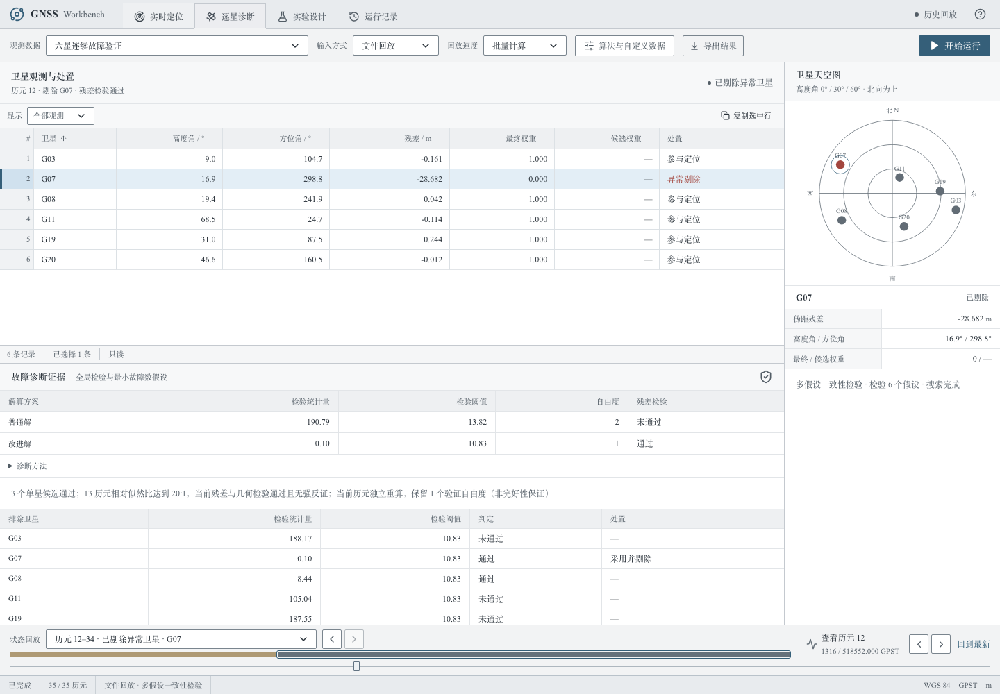

# 少星故障诊断验证计划与记录

本文件是第一轮历史快照。当前实现与最新的独立正向合成验证见 [第二轮记录](six-satellite-iteration2.md)；本页数字不代表当前默认算法。

2026-10-16。本轮只改进诊断归因，不改变课程观测模型、等权普通解、14列CSV或原始课程文件。

**交付结论：7星在本轮测试中达到数值目标，6星持续故障显著改善，但尚未全面达标。** 6星最终独立连续测试检出率89.55%、水平P95 10.17m、10m内联合成功率94.90%，均略低于课程目标；只看强故障历元时P95仍为44.56m。不能用正常段稀释后的整体指标掩盖难例，也不能把软件测试通过等同于教师验收通过。

实现位于 `core/diagnosis.py` 与 `core/solver.py`；同一引擎供CLI、文件回放及TCP使用。所有数值证据摘要见 [实验目录](experiments/low-redundancy-20261016/)，完整输入、CSV、逐候选诊断与失败清单保存在项目 `runtime/diagnosis-review-20261016/`。以下结果均在当前Mac和锁定依赖下实测；没有执行教师隐藏测试或本轮Windows现场测试。

## 最终算法与课程约束

1. 普通解仍是每历元独立的等权四未知数LS。发射时刻、广播星历、钟差/TGD、地球自转、电离层/对流层、高度角截止及PDOP计算未改动。
2. 原全局卡方检验未改动（sigma=1m、Pfa=0.001）。只在异常且至少6星时进入可验证的排除；候选必须至少保留5星、通过当前残差检验且PDOP不超过30。
3. 对多个通过的单星候选，令 `T_j = v_jᵀv_j / sigma²`，`log L_j = -T_j/2`。比较赢家与**其余所有单星假设似然之和**，不只比较前两名，也不只比较通过阈值的假设。单历元达到20:1即可采用；否则在最多16个已接收历元内累加同一故障身份的证据。每历元仍分别拟合接收机状态与任意故障幅度，不约束坐标、速度、高程或钟差。
4. 历史候选仍须通过当前检验，当前数据不能以20:1强烈反对它。历史最优被当前检验否定、当前证据明确指向新身份、正常恢复、无效/无冗余、观测集变化、时间不递增或GPST间隔超过5秒都会清空历史。网络到达速度不参与判据。
5. 多星故障仍沿用最小故障数与唯一通过规则；不能跨不同维度比较似然。歧义未消除时继续输出SUSPECT及当前普通位置，不伪造剔星或拿旧位置填补空值。被接受的改进位置使用**当前历元保留观测重新等权解算**。

该窗口只假设故障身份短时持续，残差相对似然不是校准后的正确概率。特别是近似平行的故障残差方向、短故障、冷启动与故障快速切换，仍可能漏检或错剔；它不是航空完好性保证。

兼容性证据见 [普通解对照](experiments/low-redundancy-20261016/baseline-compatibility.json)：用改动前完整求解器逐历元对照，D01/D02/D03共1220历元的普通解数值与状态完全相同；`_prepare/_linearize/_fit/_solution`的语法树未改变。少星随机序列中，因上一历元迭代初值不同造成的最大普通解数值差约3.57×10⁻⁷，远小于0.1mm检查容差，不是新增位置约束。API/IO、星历、大气模块字节不变，OpenAPI与原生成文件一致；26个教师文件逐字节一致。所有实验CSV契约违规数均为0，0/3/4星状态和空值规则回归通过。

## 最终数值结果

“旧规则”是关闭新增歧义处理的原consensus；“单历元”是仅使用当前残差似然；“新默认”使用上述至多16历元规则。P95按全部有定位结果的测试历元计算，联合成功率分母包含全部测试历元；强故障检出率只计真实单星偏差绝对值至少30m的历元。未丢弃SUSPECT、错误解或故障初始段。

开发集：D02前80历元、前6/7星、每星正负30m、10历元正常+60历元故障+10历元恢复，共26条序列、2080历元。

| 星数 | 方法 | 水平P95/m | 10m内联合成功率 | 强故障检出率 |
|---|---|---:|---:|---:|
| 6 | 旧规则 | 19.17 | 66.04% | 49.03% |
| 6 | 单历元 | 19.17 | 71.04% | 59.44% |
| 6 | 新默认 | 2.37 | 96.77% | 95.69% |
| 7 | 旧规则 | 18.03 | 90.00% | 86.67% |
| 7 | 单历元 | 2.05 | 97.59% | 96.79% |
| 7 | 新默认 | 1.91 | 99.91% | 99.88% |

开发集新默认无错剔、无正常误报。6星首次检出最多延迟10秒，7星最多1秒；这些延迟期间的误差和漏检均计入指标。

最终独立生成集（种子2026101801）：D02后半段、全部28种6星子集及8种7星子集，正负阶跃、渐变、正常、全星共同+100m、直接换星；故障幅度30/45/80/120m、额外0.25m高斯噪声。共180条序列、10800历元，6星8400、7星2400。它与开发集共享D02的轨道和轨迹来源，并非独立实测数据。

| 星数 | 方法 | 水平P95/m | 10m内联合成功率 | 强故障检出率 | 错剔历元/全部历元 |
|---|---|---:|---:|---:|---:|
| 6 | 旧规则 | 46.18 | 81.45% | 59.21% | 1/8400 |
| 6 | 单历元 | 44.90 | 84.38% | 65.54% | 2/8400 |
| 6 | 新默认 | 10.17 | 94.90% | 89.55% | 4/8400 |
| 7 | 旧规则 | 2.88 | 99.58% | 99.91% | 0/2400 |
| 7 | 单历元 | 2.68 | 99.96% | 100% | 0/2400 |
| 7 | 新默认 | 2.61 | 100% | 100% | 0/2400 |

新默认两组均100%输出当前位置，无正常误报。6星强故障共4040历元，仅强故障段的P95为44.56m、10m内成功率90.47%；7星1078个强故障历元的P95为2.78m、成功率100%。6星有4段未确认故障；在确认过的故障段中首次检出延迟P95为13秒、最大40秒；7星强故障段均首历元确认。全部SUSPECT仍计入统计。

6星困难主要在阶跃与直接换星：两类全序列P95分别49.93m和14.17m；渐变为6.69m，正常为2.36m，共同偏差为2.58m。4个错剔历元中的最大水平误差84.85m，具体卫星、历元、输入可由 [失败样例](experiments/low-redundancy-20261016/failure-examples.json) 追溯。错剔风险不能用较低的总体错剔比例掩盖。

单历元冷启动压力测试（种子2026101802）覆盖每种6/7星子集的每颗目标星和正负偏差，共448个独立样例。没有历史时“单历元”与“新默认”完全相同：6星检出率74.11%→78.87%、P95 47.35m→46.07m，仍有71/336个无法确认的样例；7星检出率98.21%→100%、P95 2.62m→2.39m。新默认均无错剔。该结果说明连续数据的收益不能推广为任意单历元六星必然可诊断。

[最终目标对照JSON](experiments/low-redundancy-20261016/validation-final-target_comparison.json) 明确记录6星三项数值目标为false、7星为true；没有把脚本正常退出解释成精度达标。

## 回归与复现

- Python：79项pytest通过（包括新增似然、少星、重置、因果性、顺序不变性、配置及TCP分包一致性测试）；Ruff与Pyright通过。
- 前端：13项Vitest、ESLint、生产构建通过；Chromium/WebKit合计16项Playwright通过。新增流程核对“多个候选通过”与“实际采用并剔除”分开呈现，历史回放依据与manifest一致。
- D02：600历元、P95 1.5904m、零误报；D03：普通23.8588m→改进1.5942m，60/60强故障检出，30个观测不足历元和20个四星历元状态正确；D01：20历元可解，无独立真值不评价精度。24个卫星检查点最大位置差约7.53×10⁻⁷m。
- 当前未改变依赖及锁文件。生产包构建有既有图表分块大小提示，pytest有Starlette/httpx弃用提示，不影响本次检查；未将未来依赖兼容性视为已验证。

```bash
uv run pytest -q
uv run python scripts/verify_fixture.py
uv run python scripts/validate_course.py
uv run python scripts/validate_low_redundancy.py --suite dev --out runtime/reproduce-dev
uv run python scripts/validate_low_redundancy.py --suite validation --seed 2026101801 --out runtime/reproduce-validation
uv run python scripts/validate_low_redundancy.py --suite cold --seed 2026101802 --out runtime/reproduce-cold
pnpm --dir web test:e2e
```

每次选择空输出目录。验证脚本分别输出输入、派生真值、配置/核心代码哈希、两套CSV、诊断、课程评价、完整失败清单、目标对照；真值只进入事后评价。三个算法使用完全相同输入。`--disable-ambiguity-resolution`可恢复原判据，`--fde-history-epochs 1`用于单历元消融，`--disable-fde`仍完全关闭诊断。窗口和阈值写入已有manifest，额外诊断字段只添加在已有candidate_scores字典内，14列课程CSV不增加字段。



提交前仍需使用现场机器和老师的回放程序预演，并将本记录纳入原技术报告草稿；现有 `report.pdf` 是前一轮快照，不能当作本轮少星改进的完整报告。下一阶段应先研究故障方向可区分性与保守的换星证据，扩展独立轨道/噪声数据验证，避免继续在这组已看过的样本上降低阈值。

## 在改动前固定的方案和验证范围

开发证据使用上一轮审查的6个时刻、前6/7星、正负30m案例，以及D02前半段的连续故障。原方法对多个通过候选一律保留SUSPECT；简单选择最小残差在6星72个开发案例中会错剔4次，不能直接采用。

拟采用同一故障数下的高斯剖面相对似然：各候选每历元独立估计XYZ、钟差及自由故障幅度，累计无故障子集残差平方和，不累计坐标或把旧位置作为约束。只有当前候选检验通过、几何合格、当前最优与累计最优一致，且相对其余候选的似然比至少20:1时才允许消除原有歧义。20:1是公开的经验选择门槛，不是正确概率或航空完好性保证。短窗口拟限制为8个历元、相邻GPST间隔不超过5秒；正常恢复、观测集变化、非递增时间、长间隔和无效数据须清空历史。保留关闭歧义处理和单历元窗口的消融。

独立验证在实现固定后使用种子2026101701、D02后半段、全部28种6星子集和8种7星子集，组合不同目标卫星、正负阶跃/渐变、共同偏差、正常及故障切换。另用种子2026101702生成单历元冷启动压力样本。它们仍共享D02轨道/轨迹，不能称为教师隐藏集或独立实测。所有输入、配置、哈希、逐星证据和失败样本保存；首次检出延迟、错剔率及SUSPECT比例与精度/可用率同时报告，绝不剔除难历元改善指标。无法区分的几何必须保留SUSPECT，不能保证任意6星组合都达标。

回归包含24个卫星检查点、D01/D02/D03、共同偏差、0/3/4星、秩不足与高PDOP、CSV空值/列名、文件/TCP一致性、消融及普通解对照。API记录结构保持兼容，新增诊断依据使用现有candidate_scores字段。算法阈值和窗口配置应进入已有manifest。

依据：课程MODEL_SPEC第5节和INTERFACE；ESA Navipedia [RAIM Fundamentals](https://gssc.esa.int/navipedia/index.php/RAIM_Fundamentals)区分检测与排除，[RAIM Algorithms](https://gssc.esa.int/navipedia/index.php/RAIM_Algorithms)区分单历元与使用历史观测的序贯诊断。本实现不使用载波相位，不声称实现RRAIM或认证保护水平。

## 实际验证结果

开发阶段发现，要求累计最优必须等于当前最小残差者，会使6星连续故障在噪声波动时反复退回SUSPECT。实际采用更合适的门槛：累计候选须通过当前残差/几何检验，当前数据不能以同样20:1门槛强烈反对该候选；当前数据若以20:1明确支持新故障身份，则重置旧窗口。这个修订在独立验证之前确定。弱的当前最小值变化不是故障换星的充分证据。该历史假设仍可能在近乎不可区分的故障切换中失效，须单独记录错剔与延迟。

下述开发选择及第一轮修订保留作为过程记录；最终通过与未达标结果以上表及对应哈希为准。

窗口长度在开发集比较8、16和32个历元。6星正负30m持续故障中，8历元的强故障检出率87.9%，16历元95.7%，32历元96.3%，均未出现错剔；选择16历元限制旧证据保留长度，不选择收益很小的32历元。最终默认仍为sigma=1m、全局虚警概率0.001，不通过降低普通解或全局诊断阈值获得改善。窗口16、相邻GPST最大间隔5秒、似然比20:1在独立验证前冻结。

第一轮独立验证暴露了历史重置遗漏：当旧累计最优已被当前残差/几何检验否定，却没有新的20:1单历元赢家时，旧历史仍可能把另一个并非真实故障的候选推到首位。因此增加“历史最优不在当前通过集合中就清空历史”的规则。它不使用真值，也不调整20:1或16历元参数。第一轮验证不再作为最终独立证据，保留原始结果用于解释修复；新增种子2026101801（连续验证）、2026101802（冷启动）的验证，完整记录全部样本，禁止仅保留改善案例。此计划在修复后的验证开始前记录。
