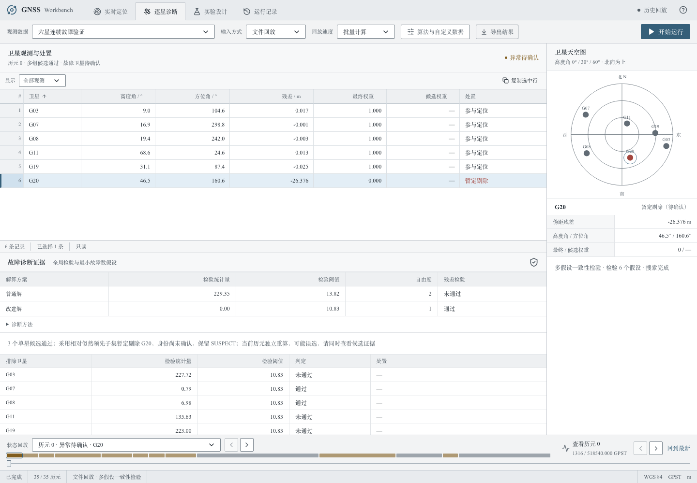

# 六星诊断第二轮：冷启动、换星与独立验证

2026-10-16。**新生成的连续测试中，各情景按课程口径达到建议指标；完全孤立的单历元冷启动仍未全面达标。** 不能把下面的连续结果推广为任意六星几何、任意噪声下都能可靠识别故障。

本轮已修改计算核心、CLI消融开关和诊断显示，保持普通解及老师的输入输出接口不变。[预设方案与开发修订](six-satellite-iteration2-plan.md) 在最终验证前记录；[冻结代码哈希](experiments/six-satellite-iteration2/frozen-code.json) 与所有最终实验manifest一致，运行最终种子后没有修改算法或参数。

## 改了什么

旧版把“能否确认故障身份”和“是否提供更合理的位置估计”绑在一起。冷启动时多个候选通过但未达到20:1，就继续输出污染的普通位置；切换故障时，旧候选仍可能通过残差门槛，让历史错误延续。

新版将以下三件事分开：

- **定位估计**：全局异常且有多个可验证的单星候选时，允许使用相对似然领先的子集提供暂定改进解。单历元使用当前最大似然候选；历史证据达到原20:1且没有当前强反证时可沿用历史候选。候选仍须通过当前残差、PDOP和至少5星检验，位置与钟差只用当前历元保留观测重新等权拟合。
- **身份确认**：暂定结果保持`SUSPECT`，只标记并实际剔除一个候选，明示可能误选。历史确认额外要求当前最优与历史最优一致，避免用强历史覆盖当前分歧；仍保留原唯一通过和单历元强证据路径。没有标记全部可疑卫星来增加召回率，也没有把暂定结果改称已确认故障。
- **换星证据**：使用带符号的故障幅度变化补充原残差检验。出现明显变化就清空历史；继续保留正常恢复、无效数据、观测集变化、时间不连续等原有重置规则。比较GPST而非网络到达时间，文件与TCP行为一致。

新增 `provisional_fde`、`fde_change_detection` 两个布尔开关，默认启用；它们进入既有manifest。sigma=1m、Pfa=0.001、似然比20:1、窗口16历元、最大间隔5秒均未调整。旧版行为可用两个关闭开关复现；关闭全部FDE仍得到等权普通解。

幅度变化检验来自线性化残差空间。令 `S=I-HH⁺`，候选j的幅度估计为 `a_j=(Sv)_j/S_jj`，方差为 `sigma²/S_jj`。把当前剔j残差统计量与相邻两次幅度差的标准化平方相加：

```
J_j = T_j(current) + (a_j(current)-a_j(previous))² / (var_j(current)+var_j(previous))
```

在身份和幅度短时不变、线性化及独立高斯噪声假设下，前项有n−5个自由度，后一项增加1个，使用已有Pfa对应的卡方(n−4)阈值。快速斜坡或真实幅度突变也可能重启证据，这比保留失效历史更谨慎。当前模拟包含小幅相关扰动，因此并不把理论Pfa或20:1解释成实际错误概率/完好性保证。新增12000组线性噪声实验验证了方差与统计量的校准。

故障排除存在可用性和错误排除风险的取舍，可参考 [Joerger与Pervan的FDE风险分析](https://www.ion.org/publications/abstract.cfm?articleID=11646)；身份正确率需要与排除后的残差检查分别考察，见 [Yang、Knight、Wang的识别概率研究](https://www.ion.org/publications/abstract.cfm?articleID=10421)。本实现是课程场景的工程方案，不是对这些论文或ARAIM的完整复现。

## 验证如何避免只适配旧数据

本轮所有旧D02派生数据只用于开发/回归。新脚本 `scripts/validate_six_satellite.py` 不读取D02伪距，也不读取D02真值来生成轨迹。它在配套星历有效范围内重新采样时间、接收机位置、三维运动、钟差、噪声、目标卫星和故障符号，并由课程观测方程正向合成伪距。生成器独立于`PositioningEngine._linearize`，无噪声反算误差低于1mm。它仍共享给定广播星历和已通过检查点的大气/轨道函数，属于新的合成测试，不是独立外场或教师隐藏测试。

- 连续种子 **621031**：全部28种六星子集，每组正常、共同偏差、首历元即故障、阶跃、渐变、一次换星、每15秒换星，共196条序列、15680历元。基础噪声0.8m，加0.25m平滑扰动；包含±30m边界和更大随机偏差。
- 孤立冷启动种子 **621032**：每种六星子集的每颗目标星、正负偏差，共336个单历元；每次新建引擎，绝无历史可用。
- 噪声失配压力种子 **621033**：另196条全新序列、15680历元，实际基础噪声2.4m而解算配置仍为1m，用来暴露模型失配。
- 每条输入分别跑旧版、仅暂定解、仅变化检验/严格确认、新默认四组，保存输入、真值、普通/改进CSV、逐候选诊断、课程评价和失败记录。正向生成时仅按高度角检查输入域，没有按定位精度或诊断成功率挑选数据。

最终验证开始后没有再调参。数值精度、10m内成功率、可用率、正确标记率、正确确认率、暂定/确认误选均分别统计。`SUSPECT`、故障首历元、换星过渡和错误解全部保留。

## 连续测试结果

“正确标记率”遵循课程`flagged_sats`口径，包含暂定和确认且必须命中真实故障星；“正确确认率”只计`FAULT_EXCLUDED`。两者不能混用。表中P95和联合成功率按各情景全部历元计算，每类2240历元。

| 情景 | 旧版P95/m | 新版P95/m | 新版10m内成功率 | 新版强故障正确标记率 |
|---|---:|---:|---:|---:|
| 正常 | 2.36 | 2.36 | 100% | — |
| 全星共同偏差 | 2.21 | 2.21 | 100% | — |
| 启动即带故障，随后连续接收 | 9.98 | 4.28 | 98.75% | 96.67% |
| 阶跃 | 14.69 | 4.17 | 97.10% | 96.85% |
| 渐变 | 5.18 | 3.98 | 98.48% | 99.82% |
| 一次直接换星 | 7.50 | 3.82 | 97.63% | 97.40% |
| 每15秒换星 | 19.13 | 4.78 | 96.29% | 95.06% |

全部15680历元的P95为5.61m→3.36m、10m内成功率96.16%→98.32%、强故障正确标记率92.42%→96.98%。可用率100%，正常历元误报率0。共同偏差钟差误差P95为2.12m。课程评价器报告CSV契约违规0。

只统计8103个强故障历元：新版P95 **4.61m**，10m内成功率 **97.16%**。启动故障、阶跃、渐变、一次换星和快速换星各自强故障段P95为5.51、5.75、2.89、4.10、8.77m，成功率98.33%、96.19%、99.82%、97.30%、95.06%。因此本轮通过不依赖正常段稀释。

对一次换星以及快速换星的**第一次切换后前10秒**单独统计，共560历元：P95 **27.87m→5.25m**，10m内成功率 **90.18%→95.71%**。该窗口定义没有包括快速换星序列后续每一次切换；全部快速换星数据已包含在上表完整情景中。

## 确认可靠性改善与新增取舍

| 范围 | 旧版错误确认 | 新版错误确认 | 旧版全部误选 | 新版全部误选（含暂定） |
|---|---:|---:|---:|---:|
| 全部连续历元 | 32 | 6 | 32 | 286 |
| 第一次换星后前10秒 | 15 | 0 | 15 | 24 |
| 孤立冷启动 | 0 | 0 | 0 | 20 |

**不能声称全部误选减少。** 新版以显式暂定解提高了定位成功率，同时增加了不确定情况下的实际误选。连续测试中正确确认率从92.42%降至89.44%，正确标记率提高到96.98%；新增结果主要是有条件的估计，不是更高的确认覆盖率。还存在6次错误确认，原唯一通过判据和强证据确认也不是绝对安全。

消融能分辨两项机制的作用：

| 方法 | 全程P95/m | 10m内成功率 | 正确标记率 | 错误确认次数 |
|---|---:|---:|---:|---:|
| 旧版 | 5.61 | 96.16% | 92.42% | 32 |
| 仅暂定解 | 3.41 | 98.16% | 96.67% | 32 |
| 仅变化检验/严格确认 | 10.63 | 94.76% | 89.44% | 6 |
| 两项同时启用 | 3.36 | 98.32% | 96.98% | 6 |

界面把暂定结果的状态保留为“异常待确认”，卫星表、详情栏及候选表均区分暂定剔除与确认剔除。诊断日志保留幅度估计、方差、变化统计量、历史重置原因和暂定依据来自当前还是历史。



## 仍未通过的情况

**完全孤立的单历元六星冷启动**：正确标记率70.83%→93.45%，10m内成功率73.81%→93.45%，P95 36.60m→23.90m。正确确认率仍为70.83%；96个暂定解中76个身份正确、20个误选，全部保持SUSPECT；另外2个强故障未触发全局检验。没有达到P95≤10m和成功率≥95%的目标。

一个新生成的反例是`set01-03-isolated`：真实G07故障却暂定选择G11。两种故障在残差空间方向的相关系数0.99986、夹角约0.96°；正确候选残差统计量0.471，错误候选0.352，均通过门槛。错误暂定解水平误差62.20m。没有历史和独立信息时，这种近乎重合的解释无法仅靠“取更小残差”可靠区分；降低阈值也不能创造额外信息。[完整冷启动歧义分析](experiments/six-satellite-iteration2/cold-ambiguity-analysis.json)保留全部20个误选。

**噪声模型失配**：实际噪声2.4m、仍配置sigma=1m时，新版全程P95 51.18m、10m内成功率80.61%、正确标记率70.56%；正常历元标记误报率约30.29%，高于旧版4.44%。新增暂定模式对失配敏感。该压力集明确未达标，不能宣传成自然多路径或高噪声下普遍更可靠。现场应按合理噪声模型配置，无法校准时可关闭暂定模式；本轮没有用压力集真值反调sigma。

下一步如果继续研究，应使用新数据验证稳健噪声尺度估计、故障可分辨性和暂定位置的风险范围，而非在这三个已公开的种子上反复挑阈值。不能通过固定高度、预知轨迹、读取未来或标记所有卫星绕过困难。

## 普通解、接口与回归

[兼容性记录](experiments/six-satellite-iteration2/compatibility.json)：用修改前代码逐历元对照，D01/D02/D03共1220历元普通解数值和状态完全一致；`_prepare/_linearize/_fit/_solution`语法树不变。新数据中不同改进迭代初值导致的最大普通解数值差低于3×10⁻⁷，低于原0.1mm迭代容差。未改变观测方程或增加时序位置约束。

API、输入输出模块、生成的OpenAPI、星历和大气模块均保持一致；14列CSV字段不变；26个教师文件逐字节一致。全部三组独立测试契约违规0。0/3/4星、无效空值、几何退化、TCP拆包/粘包及暂停恢复测试继续通过。

- Python：85项pytest通过，Ruff及Pyright通过；新增变化检验、严格确认、故意保留的错误暂定反例、方差统计校准、正向生成器反算与确定性测试。
- 前端：ESLint、13项Vitest、生产构建通过；Chromium/WebKit共16项测试通过，回放、诊断和导出流程验证暂定状态一致。
- D02：600历元P95 1.5904m、零误报；D03：普通23.8588m、改进1.5942m，60/60强故障检出，0/3/4星状态正确。D01只验证20历元兼容性，无独立真值不评价精度。

## 复现与证据

```bash
uv sync --locked
uv run pytest -q
uv run python scripts/validate_six_satellite.py --suite continuous --seed 621031 --out runtime/reproduce-six-continuous
uv run python scripts/validate_six_satellite.py --suite cold --seed 621032 --out runtime/reproduce-six-cold
uv run python scripts/validate_six_satellite.py --suite stress --seed 621033 --out runtime/reproduce-six-stress
# 同一输入恢复上一轮默认方法：
uv run gnss solve --input YOUR_INPUT.jsonl --out runtime/previous-method --disable-provisional-fde --disable-fde-change-detection
# 保留换星检验，但关闭有误选风险的暂定解：
uv run gnss solve --input YOUR_INPUT.jsonl --out runtime/confirmed-only --disable-provisional-fde
```

输出目录必须为空。脚本正常退出只代表完成运行和接口检查，是否达到精度目标查看`target_comparison.json`。原始全部输入/输出在 `runtime/six-satellite-iteration2/`；可移植的[指标、manifest、目标对照、失败输入、诊断与源码快照](experiments/six-satellite-iteration2/)位于docs目录，并有SHA256清单。旧报告PDF和第一轮文档属于历史快照，正式提交前应纳入本轮结果及未达标案例，不应仅提交成功截图。
